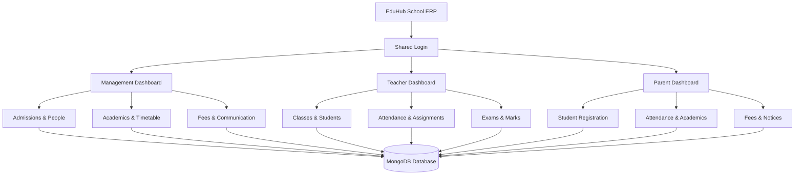
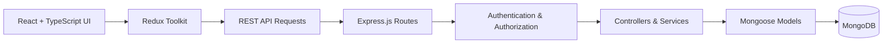

# 🎓 EduHub — School ERP Platform

<p align="center">
  <strong>One School. One Platform. Better Education Management.</strong>
</p>

<p align="center">
  A modern School ERP platform that connects school management, teachers, and parents in one place.
</p>

<p align="center">
  
  
  
  
</p>

---

## 📌 About the Project

**EduHub** is a School Enterprise Resource Planning (ERP) platform designed to simplify the daily operations of a single school.

Schools often manage admissions, student records, attendance, examinations, fees, timetables, and communication through separate systems or manual processes. EduHub aims to bring these activities together in one centralized platform.

The system provides separate, role-based dashboards for **Management, Teachers, and Parents**, allowing each user to access the information and functionality relevant to their role.

The primary goal is to build a practical, maintainable, and scalable full-stack application while applying real-world software development concepts.

## ✨ Key Features

### 🏫 Management / Admin Portal
- Overview of school activities through a centralized dashboard.
- Review and manage student admission requests.
- Approve or reject registrations with a recorded reason.
- Manage student, teacher, and parent records.
- Organize classes, sections, subjects, and timetables.
- Monitor attendance, examinations, results, and fees.
- Publish notices and manage school meetings.
- Configure school settings.

### 👩‍🏫 Teacher Portal
- View assigned classes and student information.
- Mark and manage student attendance.
- Access the teaching timetable.
- Create and manage assignments.
- Create examinations and enter student marks.
- View school notices and update profile details.

### 👨‍👩‍👧 Parent Portal
- Register and access a personal dashboard.
- Submit student admission requests.
- Track registration and approval status.
- View linked student profiles.
- Check attendance and academic performance.
- View timetables, assignments, examinations, and results.
- Monitor fee details and payment history.
- Read school notices and access meeting information.

> **Design principle:** Each role should have access only to the features and records permitted for that role.

## 🖥️ Platform Overview



## 🔄 Main Admission Workflow

One of the important workflows in EduHub is student registration and admission approval.

1. **Parent submits a request:** The parent enters the required student and guardian information.
2. **Request enters review:** The application is marked as pending.
3. **Management reviews the request:** Authorized staff verify the information and check admission requirements.
4. **Management makes a decision:** The request is approved or rejected, with a reason recorded when required.
5. **Student record is created:** When approved, the student is added to the school's records and linked to the parent account.
6. **Parent views the result:** The parent can check the registration status through the dashboard.

This workflow helps maintain a clear distinction between an admission request and an officially registered student.

## 🛠️ Technology Stack

| Area | Technology |
|---|---|
| Frontend | React, TypeScript |
| State Management | Redux Toolkit |
| Routing | React Router |
| Backend | Node.js, Express.js |
| Backend Language | TypeScript |
| Database | MongoDB |
| Object Data Modeling | Mongoose |
| Authentication | JWT |
| API Communication | REST API |
| Development Tools | Git, GitHub, Postman, VS Code |

## 🏗️ Architecture

EduHub follows a modular full-stack architecture, separating the user interface, business logic, API layer, and database operations.



### Architecture Goals
- Keep application modules organized and maintainable.
- Separate routes, controllers, services, and database models.
- Validate input on the server.
- Protect private APIs with authentication and role-based authorization.
- Handle errors consistently.
- Make the application easier to test, debug, and extend.

## 🔐 Authentication and Authorization

EduHub uses a shared login page for Management, Teachers, and Parents.

The backend verifies the user's identity and actual role before granting access. Frontend route protection improves navigation and user experience, while **backend authorization remains responsible for enforcing access permissions**.

Parent registration and staff account creation follow different workflows. Parent accounts can be registered through the parent registration flow, while teacher and management accounts are created through authorized processes.

## 📂 Project Structure

EduHub is organized as a clean modular monorepo containing a modern React SPA and an Express TypeScript API:

```text
EduHub/
├── Frontend/                      # React 19 + TypeScript + Vite SPA
│   ├── public/                    # Static assets & brand images
│   └── src/
│       ├── api/                   # Typed API service clients (Axios)
│       ├── components/            # Reusable UI components & layouts
│       ├── pages/                 # Role-specific dashboard views
│       ├── router/                # App router with protected routes
│       ├── store/                 # Redux Toolkit state slices
│       └── types/                 # Frontend TypeScript interfaces
│
├── Backend/                       # Node.js + Express + TypeScript API
│   ├── src/
│   │   ├── composition/           # Dependency injection container
│   │   ├── config/                # Environment configuration (Zod)
│   │   ├── modules/               # Domain modules
│   │   │   ├── admin/             # Admissions, classes, teachers, timetable, exams
│   │   │   ├── auth/              # JWT auth, verification, refresh sessions
│   │   │   ├── parent/            # Parent portal, children, assignments
│   │   │   └── teacher/           # Attendance, dashboard, assignments & grading
│   │   ├── shared/                # Domain errors, ApiResponse, middlewares
│   │   └── server.ts              # Express application bootstrap
│   ├── scripts/                   # Database seed scripts
│   └── tests/                     # Integration and unit tests (Vitest)
│
├── .gitignore
└── README.md
```

## ⚙️ Getting Started

### Prerequisites

Install the following before running the project:

- **Node.js**: v20 or later and npm
- **MongoDB**: Local MongoDB instance (running on port 27017) or MongoDB Atlas connection
- **Git**: Installed and configured

### 1. Clone the Repository

```bash
git clone https://github.com/AfeedaKN/EduHub.git
cd EduHub
```

### 2. Install Dependencies

Install dependencies for both the Frontend and Backend:

```bash
# Install frontend dependencies
cd Frontend
npm install

# Install backend dependencies
cd ../Backend
npm install
```

### 3. Configure Environment Variables

Create a `.env` file inside the `Backend/` directory (you can copy `Backend/.env.example`):

```bash
cd Backend
cp .env.example .env
```

Example configuration (`Backend/.env`):

```env
PORT=5000
NODE_ENV=development
MONGO_URI=mongodb://127.0.0.1:27017/eduhub
CLIENT_URL=http://localhost:5173

# JWT Configuration
JWT_ACCESS_SECRET=your_super_secret_jwt_access_key_min_32_chars
JWT_ACCESS_EXPIRY=15m
JWT_REFRESH_SECRET=your_super_secret_jwt_refresh_key_min_32_chars
JWT_REFRESH_EXPIRY_DAYS=7

# Cookie Settings
COOKIE_NAME=eduhub_refresh_token
COOKIE_SECURE=false
COOKIE_SAME_SITE=lax
```

### 4. Seed Initial Management Account

To create the default Principal / Management administrator account:

```bash
cd Backend
npm run seed:management
```

### 5. Run the Application

Start the backend API and frontend development servers in separate terminals:

```bash
# Terminal 1 - Backend Server (http://localhost:5000)
cd Backend
npm run dev

# Terminal 2 - Frontend Development Server (http://localhost:5173)
cd Frontend
npm run dev
```

### 6. Run Tests and Quality Checks

EduHub includes a comprehensive test suite (295 unit and integration tests):

```bash
# Run Backend Vitest test suite
cd Backend
npm test

# Build Backend TypeScript
cd Backend
npm run build

# Run Frontend Linting & Production Build
cd Frontend
npm run lint
npm run build
```

## 📸 Screenshots

Screenshots make the project easier to understand when someone visits the repository.

Add screenshots of your actual application to a folder such as `docs/screenshots/` and update the paths below.

| Management Dashboard | Teacher Dashboard |
|---|---|
| `docs/screenshots/admin-dashboard.png` | `docs/screenshots/teacher-dashboard.png` |

| Parent Dashboard | Admission Request |
|---|---|
| `docs/screenshots/parent-dashboard.png` | `docs/screenshots/admission-request.png` |

Once those image files exist in the repository, you can display them with Markdown:

```markdown

```

## 🗺️ Development Roadmap

- [ ] Project foundation and database connection
- [ ] Shared authentication and role-based authorization
- [ ] Management dashboard and school setup
- [ ] Parent registration and admission approval
- [ ] Teacher classroom management
- [ ] Attendance and timetable
- [ ] Assignments, examinations, and marks
- [ ] Parent academic dashboard
- [ ] Fee management
- [ ] Notices and meetings
- [ ] Validation, testing, security checks, and responsive UI

## 🎯 Project Objectives

EduHub is being developed to demonstrate practical experience with:

- Full-stack application development using the MERN ecosystem and TypeScript.
- REST API design and modular backend development.
- JWT authentication and role-based access control.
- Database schema design and relationships between school records.
- Workflow design for admissions and academic operations.
- Global state management with Redux Toolkit.
- Git and GitHub-based version control.
- Responsive UI design and integration between frontend and backend.

## 🔮 Future Enhancements

Potential future improvements include automated notifications, downloadable report cards, attendance reports, online fee payment integration, analytics dashboards, and improved search and reporting.

These enhancements can be added based on school requirements and project priorities.

## 👩‍💻 Author

**Afeeda**

Full Stack Developer in Training

---

<p align="center">
  <strong>EduHub — Bringing School Operations Together.</strong>
</p>

## Development Guidelines

- Keep TypeScript types explicit and maintainable.
- Validate incoming requests before processing them.
- Handle API errors consistently.
- Add tests when changing business logic.
- Keep frontend and backend responsibilities separate.


## API Development

- Keep API endpoints consistent and predictable.
- Validate incoming request data.
- Return clear error responses.
- Use appropriate HTTP status codes.
- Write tests for important API behaviour.


## Development Guidelines

- Keep TypeScript types explicit and maintainable.
- Validate user input before processing requests.
- Handle API errors consistently.


## API Development

- Use consistent endpoint naming.
- Return appropriate HTTP status codes.
- Validate request data.


## Testing Practices

- Test important business logic.
- Cover invalid inputs and edge cases.
- Run relevant tests before committing changes.


## Testing Practices

- Test important business logic.
- Cover invalid inputs and edge cases.
- Run relevant tests before committing changes.


## API Development

- Use consistent endpoint naming.
- Return appropriate HTTP status codes.
- Validate request data.


## Code Quality

- Follow a consistent coding style.
- Use meaningful variable and function names.
- Keep functions small and focused.
- Handle errors properly.


## Code Quality

- Use descriptive variable and function names.
- Keep functions focused on one responsibility.
- Avoid unnecessary code duplication.


## Error Handling

- Handle errors with appropriate status codes.
- Return clear and useful error messages.
- Avoid exposing sensitive information in error responses.
- Log errors to help with debugging.


## Database Management

- Design clear and consistent database schemas.
- Validate data before saving it.
- Use indexes to improve query performance.
- Handle database errors safely.


## Security Best Practices

- Hash passwords before storing them.
- Validate user input on the server.
- Protect private routes with authentication middleware.
- Keep secrets in environment variables.
- Never expose sensitive information in API responses.


## API Development

- Use consistent endpoint naming.
- Return appropriate HTTP status codes.
- Validate request data.
- Handle API errors consistently.


## Code Quality

- Follow a consistent coding style.
- Use meaningful variable and function names.
- Keep functions small and focused.
- Handle errors properly.


## Error Handling

- Handle errors with appropriate status codes.
- Return clear and useful error messages.
- Avoid exposing sensitive information in error responses.
- Log errors to help with debugging.


## Database Management

- Design clear and consistent database schemas.
- Validate data before saving it.
- Use indexes to improve query performance.
- Handle database errors safely.


## Database Management

- Design clear and consistent database schemas.
- Validate data before saving it.
- Use indexes to improve query performance.
- Handle database errors safely.


## Security Best Practices

- Hash passwords before storing them.
- Validate user input on the server.
- Protect private routes with authentication middleware.
- Keep secrets in environment variables.
- Never expose sensitive information in API responses.


## API Security

- Validate incoming request data.
- Authenticate users before accessing protected routes.
- Check user roles before allowing restricted actions.
- Use secure error responses.
- Keep API secrets in environment variables.


## Authentication

- Verify user credentials securely.
- Use JWT to protect private routes.
- Check token validity before granting access.
- Handle authentication failures properly.


## Testing Practices

- Test important business logic.
- Check invalid inputs and edge cases.
- Test API responses.
- Run relevant tests before committing changes.


## Project Maintenance

- Keep project documentation updated.
- Remove unused code and dependencies.
- Review changes before merging.
- Maintain a clear and consistent project structure.


## Project Maintenance

- Keep project documentation updated.
- Remove unused code and dependencies.
- Review changes before merging.
- Maintain a clear and consistent project structure.


## Code Reviews

- Review code before merging changes.
- Keep functions readable and focused.
- Fix bugs found during reviews.


## Environment Configuration

- Store configuration in environment variables.
- Keep secrets out of source code.
- Use an example environment file for required variables.


## API Validation

- Validate required fields.
- Reject invalid data.
- Return clear validation errors.


## Logging and Monitoring

- Log important application errors.
- Avoid logging passwords and secrets.
- Use logs to investigate unexpected behavior.


## Database Performance

- Use indexes for frequently queried fields.
- Avoid unnecessary database queries.
- Review slow queries and improve them.


## User Authorization

- Verify permissions before restricted actions.
- Allow users to access only permitted resources.
- Protect administrative operations.


## Documentation

- Document important API endpoints.
- Explain setup and installation steps.
- Keep project instructions up to date.


## Documentation

- Document important API endpoints.
- Explain setup and installation steps.
- Keep project instructions up to date.


## Performance Optimization

- Avoid unnecessary database queries.
- Optimize slow API responses.
- Reduce unnecessary processing.


## Middleware

- Keep middleware focused on specific responsibilities.
- Validate requests before processing them.
- Handle middleware errors consistently.


## Middleware

- Keep middleware focused on specific responsibilities.
- Validate requests before processing them.
- Handle middleware errors consistently.


## Role-Based Access Control

- Separate permissions by user role.
- Protect administrative endpoints.
- Verify authorization on the server.


## File Management

- Validate uploaded file types.
- Set appropriate upload size limits.
- Handle upload failures safely.


## API Response Standards

- Use consistent response structures.
- Return suitable HTTP status codes.
- Provide clear error messages.


## API Documentation

- Document endpoint URLs and HTTP methods.
- Explain required request fields.
- Include expected response formats.

